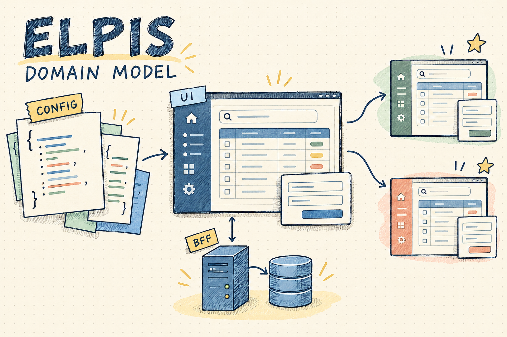
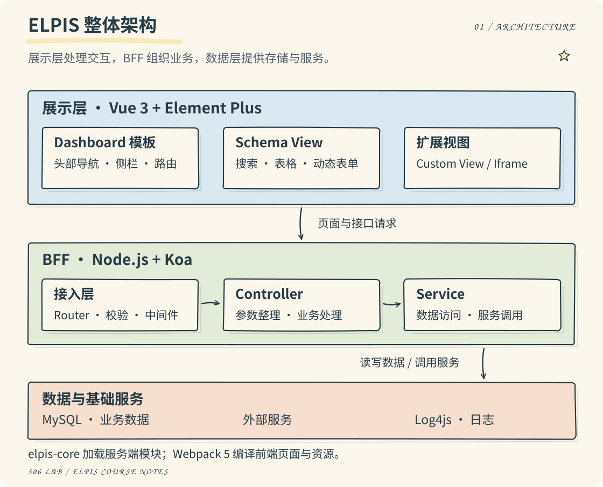
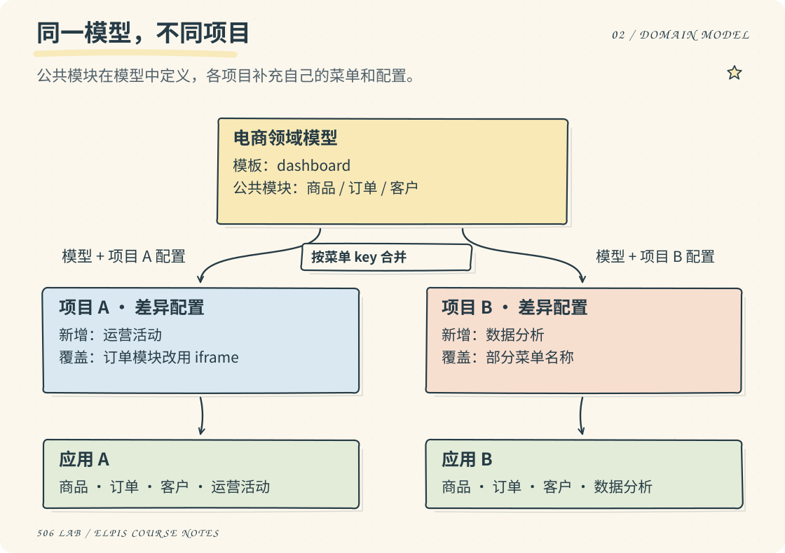
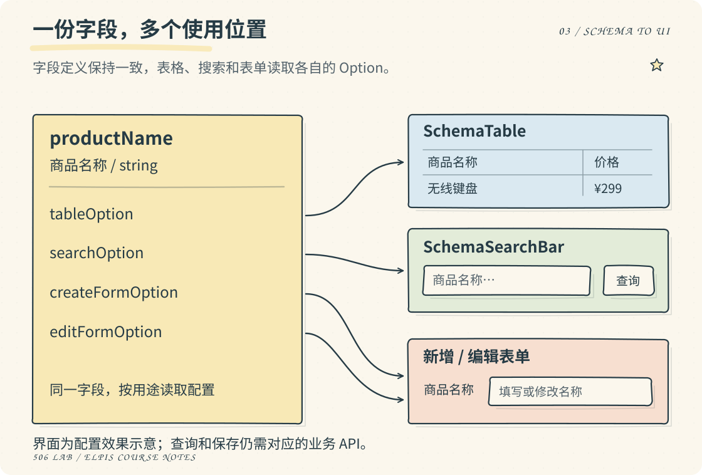
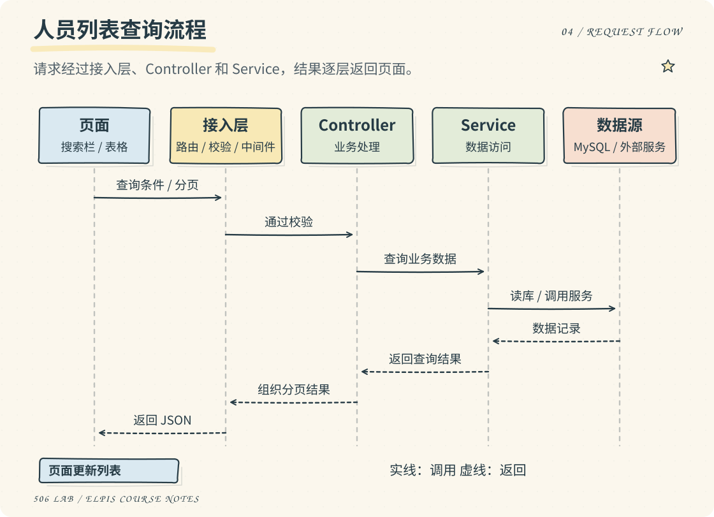
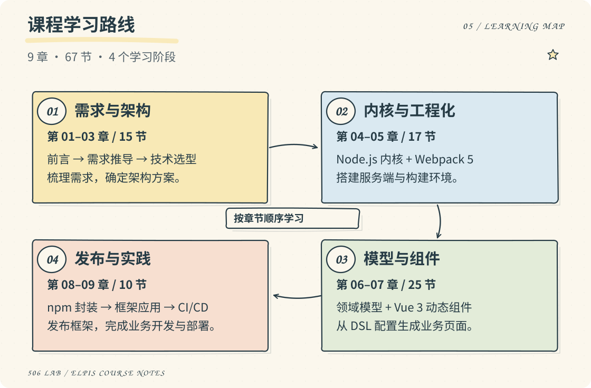

# ELPIS

基于 Vue 3 和 Node.js 的全栈应用框架，以领域模型和配置驱动中后台页面开发。



ELPIS 是「哲玄大前端全栈课程」中逐步实现的框架。课程从中后台开发中的重复需求出发，完成服务端内核、前端工程化、领域模型、动态组件，再将框架封装为 npm 包，用独立项目验证它的使用方式。

这里整理了 9 章、67 节学习笔记，保留课程中的设计思路、代码和实现步骤。

[要解决的问题](#purpose) · [整体架构](#architecture) · [领域模型](#domain-model) · [配置生成页面](#schema) · [请求流程](#request-flow) · [扩展与发布](#extension) · [课程目录](#courses)

<a id="purpose"></a>

## 要解决的问题

商品管理、订单管理、人员管理，看起来是不同的业务，页面里却经常重复出现搜索栏、表格、分页、新增和编辑表单。换一个项目，这些结构往往又要写一遍；复制已有项目，也会留下多份需要分别维护的代码。

ELPIS 将这些共性拆成模板、领域模型和通用组件。新项目继承已有模型，通过配置调整菜单、字段、接口和操作按钮。遇到特殊需求，再接入自定义页面或组件。

| 常见需求 | ELPIS 中的处理方式 |
| --- | --- |
| 多个项目都有商品、订单、客户管理 | 在领域模型中定义公共菜单和模块，项目配置只写差异。 |
| 同一字段出现在表格、搜索栏和表单中 | 统一定义字段，再通过不同的 Option 决定各处如何展示和使用。 |
| 某个页面需要特殊布局或交互 | 使用 Custom View，或扩展已有组件。 |
| 需要接入独立系统的页面 | 通过 Iframe View 嵌入。 |
| 接口重复处理参数、日志、异常等逻辑 | 由服务端内核、中间件和接口规则统一处理。 |

相关笔记：[需求推导](content/courses/02-requirement/03.mdx) · [项目架构设计](content/courses/03-technology-selection-and-architecture/03.mdx)

<a id="architecture"></a>

## 整体架构

ELPIS 分为展示层、BFF 层和数据层。Vue 页面负责交互，Node.js BFF 处理页面需要的接口和业务逻辑，Service 访问数据库或下游服务。



| 部分 | 课程中的实现 | 主要职责 |
| --- | --- | --- |
| 展示层 | Vue 3、Vue Router、Element Plus | Dashboard 模板、菜单路由、Schema 页面及交互组件 |
| 配置解析 | 领域模型、项目配置、DSL 解析器 | 合并模型与项目配置，生成页面所需的菜单、字段和组件配置 |
| BFF | Node.js、Koa、elpis-core | 加载模块，组织路由、中间件、Controller 与 Service |
| 数据与日志 | MySQL、Log4js | 业务数据读写与服务端日志 |
| 工程化 | Webpack 5 | 多页面入口、资源编译、开发服务与生产构建 |

`elpis-core` 按目录约定加载配置、路由、中间件、Controller 和 Service，使业务代码能够被框架识别和调用。前端由 Webpack 构建多个页面入口，每个入口内部再由 Vue Router 组织视图。

相关笔记：[技术选型](content/courses/03-technology-selection-and-architecture/04.mdx) · [服务端内核设计](content/courses/04-nodejs-server-core-engine/04.mdx) · [Webpack 工程化设计](content/courses/05-webpack5-engineering/01.mdx)

<a id="domain-model"></a>

## 领域模型与项目配置

以电商后台为例，两个客户都需要商品、订单和客户管理，但一个需要运营活动，另一个需要数据分析。公共部分放进电商模型，各自的变化留在项目配置里。



| 概念 | 描述什么 | 例子 |
| --- | --- | --- |
| 模板 | 页面布局和通用交互结构 | Dashboard 的头部导航、侧栏、内容区域 |
| 领域模型 | 一类业务共有的菜单、模块和字段 | 电商模型中的商品、订单、客户管理 |
| 项目配置 | 某个项目对模型的补充或修改 | 增加运营活动，修改菜单名称，替换模块类型 |
| 应用 | 合并配置后，由模板和组件渲染出的系统 | 使用同一电商模型的两个客户后台 |

课程中的 DSL 使用 JavaScript 对象描述配置。项目按菜单 `key` 覆盖同名项或追加新项，未修改的部分继续继承模型。解析器还要处理嵌套菜单，并避免一个项目的修改影响另一个项目。

相关笔记：[领域模型架构设计](content/courses/03-technology-selection-and-architecture/06.mdx) · [DSL 设计](content/courses/06-vue3-domain-model-architecture/01.mdx) · [DSL 解析引擎](content/courses/06-vue3-domain-model-architecture/02.mdx)

<a id="schema"></a>

## 一份字段配置如何生成页面

Schema View 将同一份字段定义交给表格、搜索栏和表单使用。字段的名称、类型集中定义，各组件读取自己对应的 Option。

下面是商品名称字段的配置节选：

```js
productName: {
  type: 'string',
  label: '商品名称',
  tableOption: { minWidth: 200 },
  searchOption: { comType: 'input' },
  createFormOption: { comType: 'input' },
  editFormOption: { comType: 'input' },
}
```



`tableOption` 决定表格列，`searchOption` 决定查询控件，`createFormOption` 和 `editFormOption` 分别决定新增、编辑时的录入方式。页面还会通过 `tableConfig` 描述按钮，通过 `componentConfig` 配置动态组件。

点击“新增”后，SchemaView 根据事件配置打开 CreateForm；表单使用 SchemaForm 渲染字段，提交成功后通知页面刷新列表。EditForm 和 DetailPanel 也通过这套动态组件机制接入。

配置负责描述界面和交互，业务 API 仍需实现。例如人员管理中，搜索条件、分页参数和返回字段需要与 Controller、Service 约定一致，页面才能正确查询和展示数据。

相关笔记：[SchemaTable](content/courses/06-vue3-domain-model-architecture/13.mdx) · [SchemaSearchBar](content/courses/06-vue3-domain-model-architecture/17.mdx) · [动态组件 DSL](content/courses/07-vue3-dynamic-component-library/01.mdx) · [SchemaForm](content/courses/07-vue3-dynamic-component-library/03.mdx)

<a id="request-flow"></a>

## 一次查询的请求流程

以人员列表查询为例，页面将搜索条件和分页参数发送给 BFF。请求经过路由、校验和中间件，交给 Controller 组织业务，再由 Service 读取数据。



| 模块 | 负责的事情 |
| --- | --- |
| Router、Schema、Middleware | 匹配接口，校验参数，执行配置的登录检查、日志或异常处理等逻辑。 |
| Controller | 整理请求参数，调用所需服务，组织业务结果。 |
| Service | 封装数据库读写或外部接口调用，供不同业务复用。 |

页面请求和 API 请求都由服务端内核组织，最终分别返回页面内容或 JSON 数据。登录、登出、人员查询与修改等功能，在后续业务项目中接入和验证。

相关笔记：[BFF 方案设计](content/courses/03-technology-selection-and-architecture/05.mdx) · [登录校验与登出](content/courses/09-bonus-framework-application-and-practice/04.mdx) · [人员管理模块](content/courses/09-bonus-framework-application-and-practice/05.mdx)

<a id="extension"></a>

## 扩展与发布

常规列表、搜索和表单使用 Schema View；不适合配置表达的页面，通过 Custom View 编写 Vue 页面；已经独立部署的系统，可以通过 Iframe View 接入。特殊字段控件和业务面板也有组件扩展入口。

框架完成后，课程将它抽离为 npm 包，并建立独立的 `elpis-demo` 项目使用它。

| 框架包保留 | 业务项目提供 |
| --- | --- |
| 服务端内核与通用中间件 | 业务 Controller、Service 和接口规则 |
| 前端构建能力与 Dashboard 模板 | 项目的构建配置和独立页面 |
| SchemaTable、SchemaSearchBar、SchemaForm 等组件 | 模型、项目配置及自定义组件 |
| 模块加载和扩展约定 | 具体数据源、登录与业务功能 |

拆包过程中需要分清框架目录和业务项目目录，也要确认使用方能覆盖或补充哪些能力。课程先通过 `npm link` 联调，发布后再用独立项目验证包入口、依赖和构建结果。最后继续完成 CI/CD、登录鉴权和人员管理。

相关笔记：[框架抽离](content/courses/08-framework-npm-package-and-release/01.mdx) · [页面与组件扩展](content/courses/08-framework-npm-package-and-release/04.mdx) · [npm 发布](content/courses/08-framework-npm-package-and-release/05.mdx)

<a id="courses"></a>

## 课程路线与章节



| 章节 | 主要内容 | 小节数 |
| --- | --- | ---: |
| [01 · 前言](content/courses/01-introduction/01.mdx) | 课程背景、适合人群与学习方式 | 6 |
| [02 · 行业分析与需求推导](content/courses/02-requirement/01.mdx) | 中后台重复需求、框架目标、领域模型思路 | 3 |
| [03 · 技术选型与架构设计](content/courses/03-technology-selection-and-architecture/01.mdx) | 整体分层、技术选型、BFF 与前端领域模型 | 6 |
| [04 · Node.js 服务端内核](content/courses/04-nodejs-server-core-engine/01.mdx) | 项目初始化、Git 协作、elpis-core 的设计与实现 | 10 |
| [05 · Webpack 5 工程化](content/courses/05-webpack5-engineering/01.mdx) | 多页面构建、资源处理、开发环境与前端基础 | 7 |
| [06 · Vue 3 领域模型](content/courses/06-vue3-domain-model-architecture/01.mdx) | DSL 解析、Dashboard、视图、表格与搜索栏 | 19 |
| [07 · Vue 3 动态组件](content/courses/07-vue3-dynamic-component-library/01.mdx) | 动态组件机制、表单、新增、编辑与详情 | 6 |
| [08 · npm 包封装与发布](content/courses/08-framework-npm-package-and-release/01.mdx) | 框架抽离、扩展边界、独立项目联调与发布 | 5 |
| [09 · 框架应用与项目实践](content/courses/09-bonus-framework-application-and-practice/01.mdx) | CI/CD、登录校验、登出与人员管理 | 5 |

初次学习建议按顺序阅读，后面的实现依赖前面的代码。复习时可以先看第三章的架构，再对照第六、七章的配置和组件实现，最后用第九章的人员管理串起完整流程。

## 课程来源

本笔记由 506 实验室学习「哲玄大前端全栈课程」时整理，仅供实验室成员学习、查阅和复习。笔记省略了部分演示过程，需要配合原课程阅读；如有出入，以原课程为准。

课程版权归原作者所有，请勿对外转发、打包分发或建立镜像站点。
